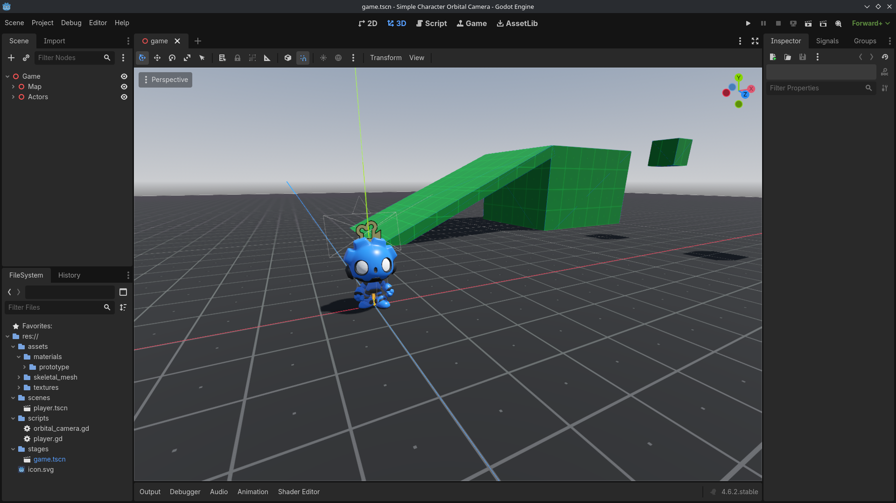

# Simple Character Orbital Camera (Word of Warcraft/MMO style)

## Donate 🙇🏼‍♂️❤️
- [ko-fi.com/rayumie](https://ko-fi.com/rayumie)

## About

The goal was to create an orbital character camera, similar to those in games like World of Warcraft/MMOs, focusing on code simplicity and ease of modification for any other project.

## Controls
| Action        | Keyboard        |
| ------------- | --------------- |
| Walk          | [W] [A] [S] [D] |
| Rotate Camera | [RMB]           |
| Jump          | [Space]         |

* It is possible to walk while holding down the right mouse button to guide the character.

## Video Demo
- [youtu.be/kDzNqjzT_xk](https://youtu.be/kDzNqjzT_xk)

## Credits
Gobot by GDQuest - [godot-4-3D-Characters](https://github.com/gdquest-demos/godot-4-3D-Characters)

## Contributors
"Simple Character Orbital Camera" is made by Rafael "Rayumie" Pimenta, 2026.
